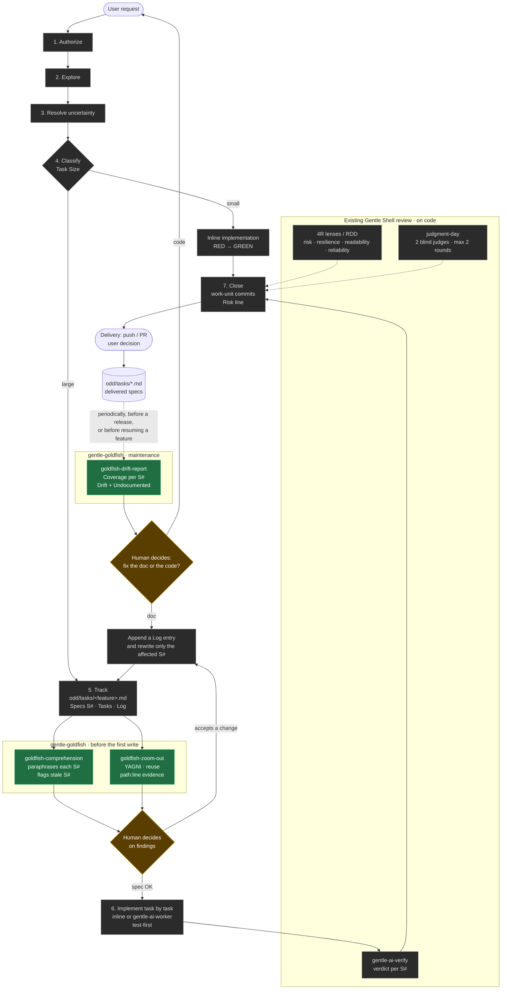

# gentle-goldfish

Fresh-context review skills for [Pi](https://pi.dev) and Gentle Shell.

A **goldfish** is a reviewer that starts with no conversation history. It
reads the document and the repository, never the discussion that produced
them, so it cannot fill gaps with what the author already knows. The idea
comes from Google's
[Elephant-Goldfish Model](https://github.com/google/elephant-goldfish-model);
this package adapts three of its reviewers to Pi and to Gentle Shell's ODD
feature documents (`odd/tasks/<feature>.md`).

## Skills

| Skill | When to use it | What you get |
|---|---|---|
| `goldfish-comprehension` | Before implementing a large spec | A paraphrase of what the spec asks for (per `S#`), plus undefined terms and assumed knowledge |
| `goldfish-zoom-out` | Before implementing a plan that adds modules or helpers | YAGNI, duplication, and over-engineering findings, each reuse claim backed by `path:line` |
| `goldfish-drift-report` | Periodically, or when old specs may be stale | Only the places where specs and current code diverge |

All three are read-only. They change no files; the human decides what to do
with each finding.

A single run is not exhaustive: each run can miss a different finding.
The drift report lists every spec it checked (a coverage line per `S#`) so
gaps are visible, but for an audit that matters, run it twice and merge the
results.

## Install

**Gentle Shell (standalone `gentle-shell`).** It runs Pi in its own home,
`~/.gentle-shell/agent`, so install the package there:

```bash
PI_CODING_AGENT_DIR=~/.gentle-shell/agent pi install git:github.com/asolis87/gentle-goldfish
```

**Gentle Shell with `gentle-shell --link`, or plain Pi.** Both use your Pi
home, `~/.pi/agent`:

```bash
pi install git:github.com/asolis87/gentle-goldfish
```

Restart the session, or run `/reload`, to load the skills.

Or try it in plain Pi for one session:

```bash
pi -e git:github.com/asolis87/gentle-goldfish
```

## Use

```text
/skill:goldfish-comprehension odd/tasks/my-feature.md
/skill:goldfish-zoom-out odd/tasks/my-feature.md
/skill:goldfish-drift-report odd/tasks/
```

The model can also pick them up when your request matches their description.

## Requirements

- A Pi session that can start subagents (`subagent_run`). Gentle Shell
  provides this and the read-only `gentle-ai-explore` agent the skills
  prefer.
- Without subagents, the comprehension and zoom-out reviews stop instead of
  running in the same context: a same-context review is not a goldfish
  review. The drift report falls back to checking documents inline and says
  so.

## How it fits Gentle Shell

Gentle Shell already reviews **code** after implementation (4R lenses,
judgment-day, verification). These skills review the **plan** before
implementation, where cutting scope or fixing an ambiguous spec is cheapest,
and check later whether specs still match the code. They do not replace any
Gentle Shell review.



- **Before implementation** (large tasks only): comprehension and zoom-out
  review the new feature document while no code exists yet.
- **After implementation:** Gentle Shell's verification, 4R lenses, and
  judgment-day run unchanged.
- **Maintenance:** the drift report runs outside the per-feature cycle, on
  specs that were already delivered.
- **Human decisions:** no skill edits files. An accepted finding becomes a
  `## Log` entry and a rewrite of only the affected `S#`, as ODD requires.

## License

Apache-2.0. Reviewer personas and the drift-report workflow are adapted from
the Elephant-Goldfish Model (Apache-2.0, Google LLC); see [NOTICE](NOTICE)
for what was changed. Not affiliated with or endorsed by Google or
Gentleman Programming.
